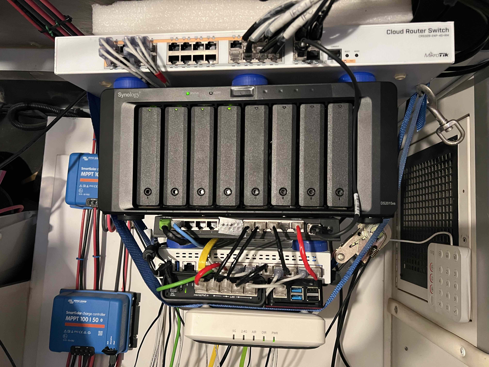
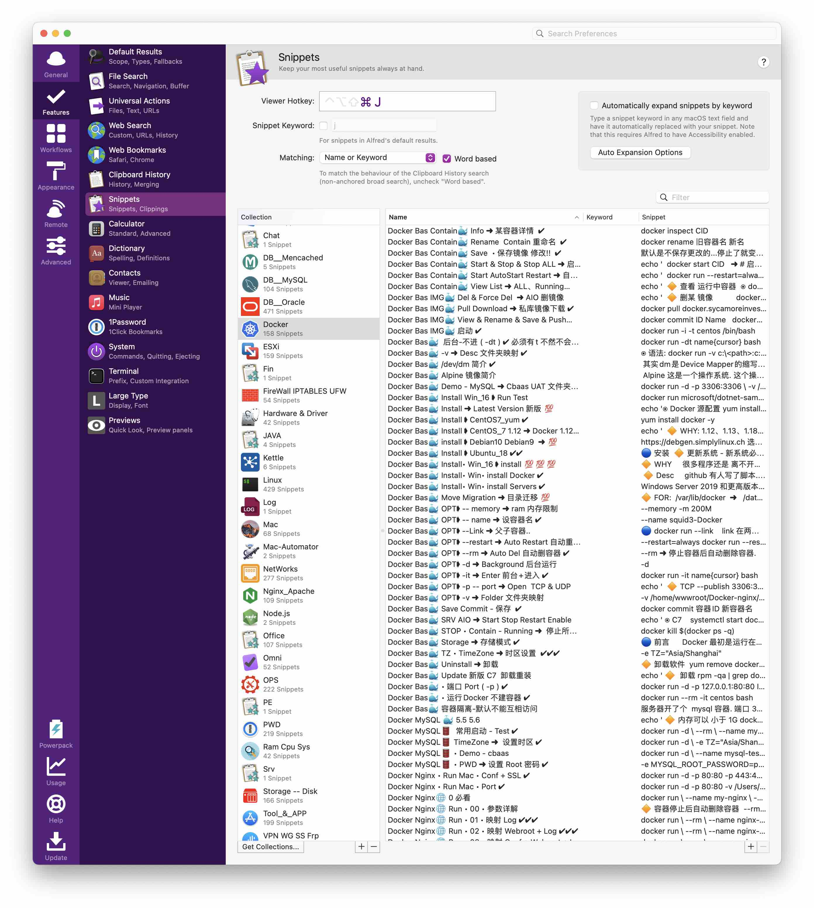

# 🦚 README


```
🟢 Repo Why

    in linux     everything is file 
    in knowledge everything is card

    i   share    everything i  know

    use cards    manage all your knowledge
    use obsidiam manage all your cards
    use homelab  show   all your know


🟢 Repo Use 

    use obsidian open this repo.
        Readme.md  ➜ cards link center 
        Cards-AIO  ➜ cards real path 
        Else       ➜ notes need Organize

    best use fixed font like jetbrains Mono


🟢 Repo Contribute 

    Telegram group:      https://t.me/+3p1p8u3C8ZE3MDIx

    free to join, Share your idea. 

    ❗️Need job in CA.US                xx2610👻protonmail.com  ❗️
    ❗️Need job in CA.US                xx2610👻protonmail.com  ❗️
    ❗️Need job in CA.US                xx2610👻protonmail.com  ❗️

```


```
🟢 Card Stru

🧬0️⃣0️⃣0️⃣0️⃣-A0z9 🐬 A.B.C ➜ xxxx
|         |    |   |      |
|         |    |   |      |
|         |    |   |      +---------------➜ Card Nmae      ➜ Search
|         |    |   +----------------------➜ Category-Abbr
|         |    +--------------------------➜ Category-Icon
|         +-------------------------------➜ Level_2        ➜ Card Sort
+-----------------------------------------➜ Level_1        ➜ Card Sort


🟢 Card Level 

group:xx                                  ➜ Group
    xx.A xx.B xx.C ...                    ➜ cards 
        xx.1 xx.2 xx.3 ...                ➜ cards 
            xx.1a xx.1b xx.1c             ➜ cards 
                xx.1a1 xx.1a2 xx.1a3      ➜ cards 


```


🟢 Misc

- [[🧬1️⃣1️⃣0️⃣0️⃣-Z000 🌐 Repo Misc ➜ Card Level ✔️]]
- [[🧬1️⃣1️⃣0️⃣0️⃣-Z000 🌐 Repo Misc ➜ Repo Abbr ✔️ ]]
- [[🧬1️⃣1️⃣0️⃣0️⃣-Z000 🌐 Repo Misc ➜ Repo Icon ✔️ ]]


# 🎪🎪🎪🎪🎪🎪🎪0️⃣0️⃣ HomeLAB
## 🎪 Lab.Summary

LAB.Pic 



LAB.Hardware 
```
Starlink_Gen2        Internet
Mofi                 Internet_LTE

FortiGate_60F        Firewall

Mikrotik_RB4011      Router 
Mikrotik_CRS328      L3-Switch
Mikrotik_HapAC2      AP-Master
Ruckus_R600          AP-Guest-Mesh_01
Ruckus_R600          AP-Guest-Mesh_02

HP-Zbook_G3          Esxi-G3 
HP-Zbook_G5          Esxi-G5

Synology_DS2015XS    NAS

Camera_IPC X 4       IPC-HDW3849H-AS-PV 
Camera_PTZ X 2


🔶 Shopping List 

    HDD:            HC550 Series         ➜ best hdd 
    Mini Server.1:  supermicro  E302-9D  ➜ 1500$+ !       small + sfp +    powerful 
    Mini Server.2:  R86s G3              ➜ 250$           small + sfp   no powerful   max-ram=16G. 

```


LAB.Hardware Choose 
- [[🧬0️⃣0️⃣0️⃣0️⃣-A000 🎪 LAB Hardware Choose ➜ Firewall ✔️]]
- [[🧬0️⃣0️⃣0️⃣0️⃣-A000 🎪 LAB Hardware Choose ➜ Camera ✔️]]


LAB.Network Summary
```
vDOM + VxLAN + BGP ...

    VM:   Server              ➜ make one machine  to many virtual machine 
    VLAN: Switch_Layer 2      ➜ make one switch   to many virtual switch 
    VRF:  Router_Layer 3      ➜ make one router   to many virtual router 
    VDOM: Firewall            ➜ make one firewall to many virtual firewall 

❗️ ros.vrf function very weak.no vxlan. just for very simple use.no recommend try it !!!!!!!! ❗️

```

LAB.Storage Summary
```


```


## 🎪👾👾👾👾👾 Lab.Prepair

```
OS Choose:  best linux os for learning is ubuntu.20/22 ➜ almost all document is based on this. 
```


###### 🟢 OS Install AIO

USB Installer Make 
- [[🧬1️⃣1️⃣0️⃣0️⃣-Z000 👾 USB ESXI ➜ Make ESXI USB Installer ✅]]
- [[🧬4️⃣0️⃣0️⃣0️⃣-Z000 👾 USB.Kali ➜ Make Kali usb installer ✔️💯]]
- [[🧬4️⃣0️⃣0️⃣0️⃣-Z000 👾 USB.Kali.RPI ➜ Make Kali install ✔️]]
- [[🧬4️⃣0️⃣0️⃣0️⃣-Z000 👾 USB.Kali.RPI.USB ➜ RPI Boot OS From USB ✅💯❗️❗️❗️❗️❗️ ]]

ESXI Custom Image  
- [[🧬1️⃣1️⃣0️⃣0️⃣-Z000 👾 ESXI.Bas ✶ Hardware ➜ compatibility Check URL ✔️]]
- [[🧬1️⃣1️⃣0️⃣0️⃣-Z000 👾 ESXI.IMG ✶ Custom Demo ➜ usb nic driver add 💯]]

PXE Server 
- [[🧬0️⃣0️⃣0️⃣0️⃣-B000 🎪 LAB.OS ➜ PXE Sever Prepair - 🚫 ]]


🟢 LAB.Misc 

DNS
- [[🧬0️⃣0️⃣0️⃣0️⃣-B000 🎪 LAB.000 ➜ DNS Record AIO ✔️]]

- [[🧬0️⃣0️⃣0️⃣0️⃣-B000 🎪 DNS URL Redriect.1 ➜ Use CloudFlare 💯]]
- [[🧬1️⃣9️⃣0️⃣0️⃣-Z000 🌐 DNS URL Redriect.2 ➜ Use other 💯]]


Git 
- [[🧬0️⃣0️⃣0️⃣0️⃣-Z000 🎪 LAB.PREP • Git ➜ Del Old Git Version ✅]]


NTP 
- [[🧬0️⃣0️⃣0️⃣0️⃣-B000 🎪 LAB.NTP ➜ Why & How ✅]]


🟢 RPI ✔️

🔶 Nic Bond
- ❗️ startech dual-usb nic no support Balance-rr fuck ❗️ 
- [[🧬0️⃣0️⃣0️⃣0️⃣-B000 🎪 LAB.000 ➜ RPI Nic Bond Balance-rr ➜ NoSupport ✅]]
- [[🧬0️⃣0️⃣0️⃣0️⃣-B000 🎪 LAB.000 ➜ RPI Nic Bond 802.3AD ✅💯]]


🔶 Docker 
- [[🧬0️⃣0️⃣0️⃣0️⃣-Z000 🎪 LAB.APP.Password Manager ➜ Docker Bitwarden 🐶]]


## 🎪🌐🌐🌐🌐🌐 Lab.NET
```
    ✅ VPN:            Wireguard + Netmaker
    ✅ DNS:            AdGuard 
    ✅ Proxy:          Traefik

```
###### 🟢 Cable ---- Map.Simple ✔️
```

vm.eg3 >>>>>>> fgt.eg3 -------- rb4.lan            >> rb4.wan   ---- fgt.vdom.def  >> www
10.32.0.xx     Transtfer.Mode   10.32.0.2/24+dhcp     10.21.0.2 ---- 10.21.0.1/30+dhcp

                                10.53.0.3/29
                                ||||||||||||
                                10.53.0.5/29

10.54.0.xx     Transtfer.Mode   10.54.0.4/24+dhcp     10.41.0.2 ---- 10.41.0.1/30+dhcp
vm.eg5 >>>>>>> fgt.eg5 -------- hap.lan            >> hap.wan   ---- fgt.vdom.def  >> www

```

###### 🟢 Cable ---- Map.Detail ✔️
```

Firewall            Router            Router            Switch            Misc    
FortiGate           Mikrotik          Mikrotik          Mikrotik  
60F                 RB4011            HapAC2            CRS328
==========================================================================================

                    SFP_01------------------------------SFP_01
                                                        SFP_02                             
                                                        SFP_03 ---------- NAS ✶ SFP_01
                                                        SFP_04 ---------- NAS ✶ SFP_02
                                                        CRS_19-24 ------- SEC ✶ Camera x 6
FGT_01-FGT -------- RB4_01-FGT                        
FGT_02-EG3 -------------------------------------------------------------- ESX ✶ HP.Zbook-G3
FGT_03-EG3 -------- RB4_03-EG3                       
FGT_04-EG5 -------------------------------------------------------------- ESX ✶ HP.Zbook-G5
FGT_05-EG5 -------------------------- HAP_04                                              
FGT_0A-FGT -------------------------------------------------------------- NAS ✶ ETH_01
FGT_0B-FGT -------------------------------------------------------------- NAS ✶ ETH_02     
FGT_08-FGT -------------------------- HAP_01
FGT_09-FGT -------------------------------------------------------------- PC  ✶ imac  
                    RB4_04-HAP ------ HAP_03                 
                    RB4_05-HAP ------ HAP_02  
                                      HAP_05 ---------------------------- SRV ✶ RPI.
                    RB4_06-APX ------------------------------------------ AP  ✶ Ruckus_R600
FGT_10-FGT <<<<<<<<<<<<<<<<<<<<<<<<<<<<<<<<<<<<<<<<<<<<<<<<<<<<<<<<<<<<<< WWW ✶ Starlink/LTE

```

###### 🟢 Table ---- VLAN & IP  ✔️

- [[🧬0️⃣0️⃣0️⃣0️⃣-B000 🎪 VLAN IP Table ✅❗️ ✔️]]


###### 🟢 Network -- Internet ✔️

- [[🧬1️⃣1️⃣0️⃣0️⃣-Z000 🌐 Net • internet.Best ➜ Visible + Mofi ]]
- [[🧬1️⃣1️⃣0️⃣0️⃣-Z000 🌐 Net • internet.Else ➜ Ros Wireless Bridge Public Wifi ✅ ]]


###### 🟢 Network -- Basic 

🔶 FortiGate

- [[🧬1️⃣1️⃣0️⃣0️⃣-Z000 🌐 FortiGate Conf ➜ Reset ✔️]]
- [[🧬1️⃣1️⃣0️⃣0️⃣-Z000 🌐 FortiGate Conf ➜ VDOM Enable ✔️]]

- [[🧬1️⃣1️⃣0️⃣0️⃣-Z000 🌐 FortiGate Conf ➜ Transfer Mode Enable ✔️ ]]
- [[🧬1️⃣1️⃣0️⃣0️⃣-Z000 🌐 FortiGate Basc ➜ NAT Mode vs Transfer Mode ✔️ ]]


🔶 Mikrotik 

- [[🧬1️⃣1️⃣0️⃣0️⃣-Z000 🌐 Ros Conf ➜ RB4 + HAP Conf Basic ✅❗️❗️❗️❗️❗️ ]]
- [[🧬1️⃣1️⃣0️⃣0️⃣-Z000 🌐 Ros Conf ➜ EBGP eg3 eg5 ✅ ]]


###### 🟢 Network -- VxLAN 

```

❗️ mikrotik fortigate use diff vxlan port, ros.8472, fgt.4789 ➜ change ros`s vxlan & vtep port to 4789 ❗️
❗️ mikrotik fortigate use diff vxlan port, ros.8472, fgt.4789 ➜ change ros`s vxlan & vtep port to 4789 ❗️
❗️ mikrotik fortigate use diff vxlan port, ros.8472, fgt.4789 ➜ change ros`s vxlan & vtep port to 4789 ❗️

```

- [[🧬1️⃣3️⃣0️⃣0️⃣-B300 🌐 NET • VXLAN ➜ Why ✔️]]
- [[🧬1️⃣1️⃣0️⃣0️⃣-Z000 🌐 NET • VxLAN.Demo Phys Nic ➜ Ros + FGT 💯 ]]
- [[🧬1️⃣1️⃣0️⃣0️⃣-Z000 🌐 Net • VxLAN.Demo VLAN Nic ➜ Manage vlan 💯 ]]
- [[🧬1️⃣1️⃣0️⃣0️⃣-Z000 🌐 Net • VxLAN.Demo Else ➜ NAS.89 + NAS.88 ✅ ]]

 
###### 🟢 VPN ------ Wireguard ✅ ?

```

🔵 VPN 

    vps.s 1214.214

    ros.c 1214.011
    ros.c 1214.022

    k3s.c 1214.033
    dkt.c 1214.144
    mac.c 1214.099

vps stoped. so ..
```


- [[🧬0️⃣0️⃣0️⃣0️⃣-B000 🎪 LAB.Net.VPN.Choose ➜ Wiregurad Netmaker ✔️]]
- [[🧬0️⃣0️⃣0️⃣0️⃣-B000 🎪 LAB.Net.VPN.Wireguard ➜ Design & Structure ✔️]]
- [[🧬0️⃣0️⃣0️⃣0️⃣-B000 🎪 LAB.Net.VPN.Wireguard ➜ AIO Misc todo ✖️]]


###### 🟢 Proxy ---- Traefik   

- [[🧬0️⃣0️⃣0️⃣0️⃣-B000 🎪 LAB.Net.Proxy.Choose ➜ Traefik ✔️]]
- [[🧬0️⃣0️⃣0️⃣0️⃣-B000 🎪 LAB.Net.Proxy.Traefik ➜ Design & Structure]]


## 🎪🔐🔐🔐🔐🔐 Lab.AAA 

```
🟢 AAA.SUM

    ✅ Radius  ➜ main for wifi  

    ✅ LDAP:  openLDAP     ad.rv.ark
    ✅ LDAP:  Synology    adnas.rv.ark
    ❌ SSO:    Authelia


🔵 Radius ✅
	Radius Server: RB4011 
	
	Radius Client:
	    RB4/HAP    winbox login ✔️
	    Fortigate  web    login ✔️
        Kali       ssh    login ✔️
        esxi ❌
        nas ❌

🔵 LDAP Account ❌

    🔶 nas 
        adu.nas ➜   user 
        ada.nas ➜   admin 

```

###### 🟢 Radius
###### 🟢 Radius - Why ✔️

```
🔶 Why 

in school  wifi need login 
in company pc   need login 

radius allow who can login. how long etc....
main for wifi.   can do to pc too. like employer.

```
###### 🟢 Raidus - Map ✔️ 

```

        >> cable - rb4011                              / main radius.server: rb4011
device  >> wifi  - ruckus  >> radius.client:fortigate <
        >> cable - hapac2                              \ back radius.server: hapac2


⚠️ ros not support sync radius server now; backup is for important account only. ⚠️ 

```

###### 🟢 Raidus - Demo ✔️ 

- [[🧬0️⃣0️⃣0️⃣0️⃣-C000 🎪 AAA Radius Demo ➜ Srv.RB4 + Cli.FGT ✅💯]]
- [[🧬0️⃣0️⃣0️⃣0️⃣-C000 🎪 AAA Radius Demo ➜ Srv.RB4 + Cli.RB4 ✅💯]]
- [[🧬0️⃣0️⃣0️⃣0️⃣-C000 🎪 AAA Radius Demo ➜ Srv.RB4 + Cli.Kali ✅💯]]


## 🎪📀📀📀📀📀 Lab.STO


###### 🟢 Storage MAP 
```
DHW  ➜ DSM.HW: Synology Hardware DS2015XS  ➜  Weak performace & Docker No   ➜  Backup NAS
DVM  ➜ DSM.VM: Synology VM       ESXI      ➜  High performace & Docker Yes  ➜  Main   NAS

                / iscis --> HW.RPI          ➜ S3  Storage
Synology.DSM -->  iscsi --> VM.Synology
		        \ iscis --> VM.CEPH         ➜ RBD Storage


🔶 Disk 

    DHW.01 ------\
    DHW.02 ------->  ISCSI ➜ Ceph Cluster
    DHW.03 ------/
    DHW.04 ------->  ISCSI ➜ DSM.VM
    DHW.05
    DHW.06
    DHW.07
    DHW.08


🔶 Function
    
    DHW.ISCSI  ➜ CEPH     ➜  K8s/K3s 
    DHW.ISCSI  ➜ DVM      ➜  Docker  Mount  +  Dropbox_sync_encrypted
    DHW.NFS    ➜ ESXI     ➜  ISO/APP Mount

```


###### 🟢 LAB.Storage Desc
```
NAS - Docker:  Synology - Hardware ➜ dsm 
NAS + Docker:  Synology - VM_esxi  ➜ dvm  ➜ no 24/7 .. only docker no important.

S3:    MinIO 
RBD:   Ceph


🔶 Function - DVM 
	- Docker 
	- Cloud Sync:  Dropbox       * 4
	- Cloud Sync:  Google Driver * 2


🔶 CEPH-RBD 
    Pool_BD-K8s-DB
    Pool_BD-K8s-APP
    Pool_BD-K3s-AIO

```


🟢 Cloud 

- [[🧬0️⃣0️⃣0️⃣0️⃣-C000 🎪 LAB.Sto.Cloud Driver ➜ Alist 🐶 ]]
- [[🧬0️⃣0️⃣0️⃣0️⃣-C000 🎪 LAB.Sto.Cloud Pic Host ➜ github ✅ ]]


## 🎪💠💠💠💠💠 Lab.APP

## 🎪🎉🎉🎉🎉🎉 Lab.MIS

🔵 LAB Misc 

- [[🧬0️⃣0️⃣0️⃣0️⃣-Z000 🎪 LAB.Mon ➜ Dashy ✔️]]
- [[🧬0️⃣0️⃣0️⃣0️⃣-Z000 🎪 LAB.Tools ]]


## 🎪🎉🎉🎉🎉🎉 MIS.Monitor


metric + influxdb + grafana


# 🚑🚑🚑🚑🚑🚑🚑🚑🚑🚑🚑🚑🚑🚑 RV & ELEC 


```
RV DIY Summary 

    - Power:           more panel less battery if possible
    - Fan:             never max air: big noise trush! fuck, try diy use Noctua NF-A20
    - Aircondition:    use mini-split  (use much less power)
    - battery moniter: bmv-712 useless.  tell capity by votage, no need fuck this. setting is crazy and not accurate 

    
```


## 🚑🚑🚑🚑🚑 RV Power 

🔵 Solar Panel 
```
Series   connect panel ➜ one panel broken.     affect whole system
Parallel connect panel ➜ one panel broken.  no affect whole system. ➜ 👍 
```


🔵 Battery 

Lifepo4 Choose 
- 1st: used tesla battery
    
Battery Charge
- [[🧬9️⃣9️⃣0️⃣0️⃣-Z000 🎉 RV Power ➜ Battery Charge Stage and Advice 💯❗️ ]]
- [[🧬9️⃣9️⃣0️⃣0️⃣-Z000 🎉 RV Power ➜ Battery Votage Table 💯 ]]

MPPT Controler
- [[🧬9️⃣9️⃣0️⃣0️⃣-Z000 🎉 RV Power ➜ MPPT Use Very Large Panel 💯 ]]


🔵 Misc 

Cable Size Choose 
- [[🧬9️⃣9️⃣0️⃣0️⃣-Z000 🎉 RV Power ➜ Cable Gague Size Choose ✔️ ]]

DC Fuse Choose ❗️
- [[🧬8️⃣0️⃣0️⃣0️⃣-Z000 🚑 ELEC Fuse Choose ➜ Blue Sea Systems Class T Fuses 💯 ]]

Misc
- [[🧬9️⃣9️⃣0️⃣0️⃣-Z000 🎉 RV Power ➜ how charge agm use lifepo4 ✔️ ]]


🟢 Elective Tool

Tool: 
```
multimeter       ➜ fluke 87v
elect   tester   ➜ 
gfci    tester   ➜ klein gfci outlet tester  ➜ test if gfci device works. 
voltage tester   ➜ klein voltage tester      ➜ test if have any power.    ➜ not for how big votage/current

```

Tool Use 
- [[🧬8️⃣0️⃣0️⃣0️⃣-Z000 🚑 ELEC test cable connect ➜ Meter Ω Func ✔️ ]]


🟢 Elective Hardware 

```
• Fuse/breaker:   ➜ prevent shortcut 

• Relay(switch):  ➜ use small votage/current control big votage/current
    current  ➜ switch small cable;  device use big cable
    votage   ➜ rpi    use   5v;     device use 12/110/220v 

```


- [[🧬8️⃣0️⃣0️⃣0️⃣-Z000 🚑 ELEC Hardware ➜ FET MOS ➜ Desc ✖️ ]]


ELEC Hardware Use
- [[🧬8️⃣0️⃣0️⃣0️⃣-Z000 🚑 ELEC Hardware• Manual ➜ ShortStop Circuit Breaker ✅ ]]


🟢 ELEC Knowledge 
- [[🧬9️⃣9️⃣0️⃣0️⃣-Z000 🎉 ELECT ➜ GFCI ]]


🟢 Ambulacne ELECT DIY

- [[🧬9️⃣9️⃣0️⃣0️⃣-Z000 🚑 Ambulance Relay Panel ❗️💯❗️  ]]


## 🚑🚑🚑🚑🚑 RV Smart

###### 🚑 Home Assistant

- [[🧬0️⃣0️⃣0️⃣0️⃣-Z000 🎪 HA OS Choose ➜ Supervised ✔️ ]]
- [[🧬0️⃣0️⃣0️⃣0️⃣-Z000 🎪 HA OS Install ➜ RPI4_Ubuntu22 Install Supervised ✅]]


###### 🟢 🚑 Home Assistant + Victron / Modbus
```
Summary 

1. update all firmware.
2. google gx_modbus-tcp_manual.pdf    modbus-tcp register list
    https://www.victronenergy.com/panel-systems-remote-monitoring/color-control#technical-information

Modbus explain 
  - name: '⚡️🔆-Head'
    unit_of_measurement: "W" 
    scale: 0.1     # show 3000w, real 300w so must need this.
    precision: 2   # if no 13v; if=1 13.1v; if=2 13.11v 
    slave: 224     # for device(unit-id) ➜ one hardware one id 
    address: 789   # for function        ➜ one fucntion one id. one hardware many function

```


🔶 Option ➜  GX Change mapping of Unit-ID / VRM-Instance ✅
- 01 [[🧬0️⃣0️⃣0️⃣0️⃣-Z000 🚑 Victron Cerbo GX ➜ Change Mapping Why ✔️ ]]
- 02 [[🧬0️⃣0️⃣0️⃣0️⃣-Z000 🚑 Victron Cerbo GX ➜ Enable SSH ✔️ ]]
- 03 [[🧬0️⃣0️⃣0️⃣0️⃣-Z000 🚑 Victron Cerbo GX ➜ Change Mapping File ✔️ ]]


🔶 Real Demo ✅
- [[🧬0️⃣0️⃣0️⃣0️⃣-Z000 🚑 HA Victron Modbus Demo ➜ Summary ✔️ ]]
- [[🧬0️⃣0️⃣0️⃣0️⃣-Z000 🚑 HA Victron Modbus Demo ➜ prepair network and server ]]
- [[🧬0️⃣0️⃣0️⃣0️⃣-Z000 🚑 HA Victron Modbus Demo ➜ HA_Docker Config File PATH ✔️]]
- [[🧬0️⃣0️⃣0️⃣0️⃣-Z000 🚑 HA Victron Modbus Demo ➜ Config File with Notes❗️💯❗️ ]]
 


how show. pic of remote console.

###### 🟢 🚑 Home Assistant + Renogy Battery??


# 📟📟📟📟📟📟📟📟📟📟📟📟📟📟 CMD AIO

CMD.G ➜ all plaform 
CMD.D ➜ Docker 
CMD.L ➜ Linux
CMD.N ➜ Net


# 📟🦚🦚🦚🦚🦚 8️⃣8️⃣ CMD.Fortigate
    🔍F.CMD.FGT🔎


# 📟🦚🦚🦚🦚🦚 8️⃣8️⃣ CMD.RouterOS
    🔍F.CMD.Ros🔎


❗️ F1 Key show available cmds ❗️

🔵 Bridge     🔍F.CMD.Ros.Bridge🔎
```
/interface bridge print          ➜ list bridge info
/interface bridge port print     ➜ lost bridge port info


🔶 Bridge VLAN Filter off ✅

/interface bridge set ✘✘✘✘✘✘✘✘✘✘✘✘ vlan-filtering=no
/interface bridge set Bridge-CRS-ALL vlan-filtering=no

```


 
# 📟🦚🦚🦚 CMD.Network


# 📟🟢 Net.Router


- [[🧬8️⃣8️⃣0️⃣0️⃣-Z000 📟 CMD Net Router CRUD ➜ Win AIO ✅]]
- [[🧬8️⃣8️⃣0️⃣0️⃣-Z000 📟 CMD Net Router CRUD ➜ Mac ✖️]]


# 📟🟢 Net.DNS

- [[🧬8️⃣8️⃣0️⃣0️⃣-Z000 📟 CMD.Net.DNS.Check ➜ nslookup Use ✔️]]
- [[🧬8️⃣8️⃣0️⃣0️⃣-Z000 📟 CMD.Net.DNS.Clear ➜ flush, Delete ✖️]]


# 📟🟢 CMD.ESXI


- [[🧬8️⃣8️⃣0️⃣0️⃣-Z000 📟 CMD.ESXI Network ➜ Nic PortGroup vSwitch ✔️]]


# 🌐🌐🌐🌐🌐🌐🌐🌐🌐🌐🌐🌐🌐🌐 1️⃣0️⃣ Network 


🟢 Simile AIO ❗️ 

```
Route:  connect diff network/language 

NAT:  translate address.
SNAT: your    to english
DNAT: english to your

```


🔵 Tool. Winbox 

- [[🧬1️⃣0️⃣0️⃣0️⃣-Z000 🌐 Net.T.Winbox.Tips ✔️]]


# 🌐🦚🦚🦚🦚🦚 1️⃣0️⃣ Network 
    🔍F.N🔎

###### 🟢 Hardware 

- [[🧬0️⃣0️⃣0️⃣0️⃣-A000 🎪 LAB.Hardware.Func • Function ➜ L3 Switch vs L3 Router 💯 ]]
- [[🧬0️⃣0️⃣0️⃣0️⃣-A000 🎪 LAB.Hardware.Func • Function Assign ➜ Why How Demo 💯 ]]

- [[🧬0️⃣0️⃣0️⃣0️⃣-A000 🎪 LAB.Hardware.Virt • VRF.Why ➜ Why Hardware Virtual ✅ ]]


🔵 Switch: Mikrotik CRS328
    L2 Switch. L3 too Weak 
    
- [[🧬0️⃣0️⃣0️⃣0️⃣-A000 🎪 LAB.HW.CRS • Hardware Offload ➜ Why ✅ ]]
- [[🧬0️⃣0️⃣0️⃣0️⃣-A000 🎪 LAB.HW.CRS • Hardware Offload ➜ Status Check ✔️ ]]
- [[🧬0️⃣0️⃣0️⃣0️⃣-A000 🎪 LAB.HW.CRS • Hw Offload Tip ➜ Use only one Bridge ✔️ ]]


# 🌐🟢 Net.Basic


🔵 Network Package

- [[🧬1️⃣1️⃣0️⃣0️⃣-Z000 🌐 Net.Bas Package-L2 ➜ Mac ❌]]
- [[🧬1️⃣1️⃣0️⃣0️⃣-Z000 🌐 Net.Bas Package-L3 ➜ IP  ❌]]


🔵 Mask 
- [[🧬1️⃣1️⃣0️⃣0️⃣-Z000 🌐 Net.Bas ✶ MASK Desc ✔️]]
- [[🧬1️⃣1️⃣0️⃣0️⃣-Z000 🌐 Net.Bas ✶ MASK.30 IP Table ✔️]]
- [[🧬1️⃣1️⃣0️⃣0️⃣-Z000 🌐 Net.Bas ✶ MASK Demo ➜ router ip ✖️]]


🔵 Misc

- [[🧬1️⃣1️⃣0️⃣0️⃣-Z000 🌐 Net.Bas ✶ TCP vs UDP ✔️]]
- [[🧬1️⃣1️⃣0️⃣0️⃣-Z000 🌐 Net.Bas.Router Type ➜ PE CE ✔️]]


# 🌐🟢 Net.Advance


# 🌐🟢 Net.Wireless 

- [[🧬1️⃣1️⃣0️⃣0️⃣-Z000 🌐 Net.Wireless.Antenna ➜ type ✔️]]
- [[🧬1️⃣1️⃣0️⃣0️⃣-Z000 🌐 Net.Wireless.Antenna ➜ Signal Strength ✔️]]

- [[🧬1️⃣1️⃣0️⃣0️⃣-Z000 🌐 Net.Wireless.Wave.Direction ✔️]]

- [[🧬1️⃣1️⃣0️⃣0️⃣-Z000 🌐 Net.Wireless.Signal Effect item ✔️]]
- [[🧬1️⃣1️⃣0️⃣0️⃣-Z000 🌐 Net.Wireless.Signal SNR AIO✔️]]


- [[🧬1️⃣1️⃣0️⃣0️⃣-Z000 🌐 Net.wifi.channel.choose ➜ 2G vs 5G ✔️]]
- [[🧬1️⃣1️⃣0️⃣0️⃣-Z000 🌐 Net.wifi.band desc ➜ 20MHz 40MHz ✔️]]


# 🌐🦚🦚🦚🦚🦚 1️⃣0️⃣ Firewall Knowledge
    🔍F.FGT.Basic🔎
    Firewall Basic Knowledge


🔵 FortiGate Basic 

- [[🧬1️⃣1️⃣0️⃣0️⃣-Z000 🌐 FGT.Bas.Nic ➜ Delete Grey Nic ✅ ]]


🔵 Firewall:  FortiGate_60F 

- [[🧬0️⃣0️⃣0️⃣0️⃣-A000 🎪 LAB.Hardware.FGT Firewall ➜ vlink Desc ✔️ ]]
- [[🧬0️⃣0️⃣0️⃣0️⃣-A000 🎪 LAB.Hardware.FGT Firewall ➜ NPU-vlink Desc ✔️ ]]


🔵 Firewall Config 

- [[🧬0️⃣0️⃣0️⃣0️⃣-A000 🎪 LAB.NET.Demo.FGT VDOM ➜ Internet config ✅💯 ]]


🟢 simple 
```
NAT    ➜  connect LAN & WWW 
Mangle ➜  mark add/check 

```


###### 🟢 Firewall.NAT ✅❗️ 


- [[🧬1️⃣1️⃣0️⃣0️⃣-Z000 🌐 Firewall.NAT ➜ Summary]]
- [[🧬1️⃣1️⃣0️⃣0️⃣-Z000 🌐 Firewall.NAT ➜ SNAT DNAT Masquerade Diff AIO ✅❗️]]
- [[🧬1️⃣1️⃣0️⃣0️⃣-Z000 🌐 Firewall.NAT ➜ WHY ]]
- [[🧬1️⃣1️⃣0️⃣0️⃣-Z000 🌐 Firewall.NAT ➜ snat vs masquerade ✅ ]]
- [[🧬1️⃣1️⃣0️⃣0️⃣-Z000 🌐 Firewall.NAT ➜ snat nic_x nic_all diff ✅ ]]


###### 🟢 Firewall Misc

- [[🧬1️⃣1️⃣0️⃣0️⃣-Z000 🌐 FGT • Bas ➜ Timeout ✔️]]

firewall.mangle.pathhrough:  if match. go to next firewall rule


# 🌐🦚🦚🦚🦚🦚 1️⃣0️⃣ RouterOS AIO
    🔍F.Ros.Basic🔎


- [[🧬1️⃣3️⃣0️⃣0️⃣-B300 🌐 NET.Route • Ros BGP Share Default route ✔️ ]]


# 🌐🟢 Ros.CMD AIO 


- [[🧬1️⃣3️⃣0️⃣0️⃣-B300 🌐 Ros CMD ➜ Bridge ✔️ ]]
- [[🧬1️⃣3️⃣0️⃣0️⃣-B300 🌐 Ros CMD ➜ VRF ✔️ ]]


✶ VRF Demo, works but not use any more.

    - VRF.HAP   [[🧬1️⃣1️⃣0️⃣0️⃣-Z000 🌐 NetBuild HAP.Conf.CMD ➜ AIO ✅❗️❗️❗️❗️❗️ ]]
    - VRF.RB4   [[🧬1️⃣1️⃣0️⃣0️⃣-Z000 🌐 NetBuild RB4.Conf.CMD ➜ AIO ✅❗️❗️❗️❗️❗️ ]]
    - VRF.BGP   [[🧬1️⃣1️⃣0️⃣0️⃣-Z000 🌐 NetBuild Route.EBGP AIO ➜ EG3 EG5 RB4 HAP ✅❗️❗️❗️❗️❗️ ]]


🔵 Demo. Basic.VRF

- [[🧬1️⃣1️⃣0️⃣0️⃣-Z000 🌐 Ros.VRF.CMD ➜ AIO ✔️]]


- [[🧬1️⃣1️⃣0️⃣0️⃣-Z000 🌐 Ros.VRF.Order ➜ Desc + Demo❗️]]
- [[🧬1️⃣1️⃣0️⃣0️⃣-Z000 🌐 Ros.VRF.Nic ➜ Physical + VLAN ✔️]]

- [[🧬1️⃣1️⃣0️⃣0️⃣-Z000 🌐 Ros.VRF.Demo.How ✔️]]
- [[🧬1️⃣1️⃣0️⃣0️⃣-Z000 🌐 Ros.VRF.Demo.How.1 ➜ VRF Prepair ip ✔️]]
- [[🧬1️⃣1️⃣0️⃣0️⃣-Z000 🌐 Ros.VRF.Demo.How.2 ➜ VRF Create + Order ✔️]]
- [[🧬1️⃣1️⃣0️⃣0️⃣-Z000 🌐 Ros.VRF.Demo.How.3 ➜ VRF Default Route ✔️]]
- [[🧬1️⃣1️⃣0️⃣0️⃣-Z000 🌐 Ros.VRF.Demo.How.4 ➜ VRF Firewall masquerade ❗️]]

- [[🧬1️⃣1️⃣0️⃣0️⃣-Z000 🌐 Ros.VRF.Demo.AIO ➜ Ros CRS✖️]]
- [[🧬1️⃣1️⃣0️⃣0️⃣-Z000 🌐 Ros.VRF.Demo.00 ➜ VRF Design ✖️]]


🔵 Demo. Basic.Route

- [[🧬1️⃣1️⃣0️⃣0️⃣-Z000 🌐 Net.Route.type ➜ Direct + Static + dynamic ⭐️⭐️⭐️⭐️]]
- [[🧬1️⃣1️⃣0️⃣0️⃣-Z000 🌐 Net.Route.Dynamic Route ➜ OSPF BGP ➜ Why ✔️]]
- [[🧬1️⃣1️⃣0️⃣0️⃣-Z000 🌐 Net.Route.Dynamic Route ➜ OSPF BGP ➜ Diff]]


🔵 Demo. Basic.OSPF 

- [[🧬1️⃣1️⃣0️⃣0️⃣-Z000 🌐 Net.OSPF.Bas ➜ Disenable Enable ✔️]]
- [[🧬1️⃣1️⃣0️⃣0️⃣-Z000 🌐 Net.OSPF.Bas ➜ DR BDR ➜ Desc ✔️]]
- [[🧬1️⃣1️⃣0️⃣0️⃣-Z000 🌐 Net.OSPF.Bas ➜ DR BDR ➜ Choose ✖️]]
- [[🧬1️⃣1️⃣0️⃣0️⃣-Z000 🌐 Net.OSPF.Bas ➜ Zone ➜ Desc & Why ✔️]]


🔵 OSPF. Demo

- [[🧬1️⃣1️⃣0️⃣0️⃣-Z000 🌐 Ros.OSPF.Demo ➜ OSPF Devices ✅]]
- [[🧬1️⃣1️⃣0️⃣0️⃣-Z000 🌐 Ros.OSPF.Demo ➜ Router IP ➜ Design ✅]]

all route device need set ospf
- [[🧬1️⃣1️⃣0️⃣0️⃣-Z000 🌐 Ros.OSPF.STEP.00 ➜ Device IP Setup ✅]]
- [[🧬1️⃣1️⃣0️⃣0️⃣-Z000 🌐 Ros.OSPF.STEP.10 ➜ RouterID loopback ➜ Desc Diff ✅]]
- [[🧬1️⃣1️⃣0️⃣0️⃣-Z000 🌐 Ros.OSPF.STEP.11 ➜ loopback Create ❌ ]]
- [[🧬1️⃣1️⃣0️⃣0️⃣-Z000 🌐 Ros.OSPF.STEP.12 ➜ loopback Set IP ✔️ ]]
- [[🧬1️⃣1️⃣0️⃣0️⃣-Z000 🌐 Ros.OSPF.STEP.13 ➜ RouterID Create ✔️ ]]

- [[🧬1️⃣1️⃣0️⃣0️⃣-Z000 🌐 Ros.OSPF.STEP.13 ➜ OSPF Status Check ✔️ ]]


🔵 Router 

- [[🧬1️⃣1️⃣0️⃣0️⃣-Z000 🌐 Lab.Net.Basis ➜ AS Number AIO ✅]]


🟢 Ros.VRF+MPLS

🔵 VRF + VLAN ✔️

- [[🧬1️⃣1️⃣0️⃣0️⃣-Z000 🌐 Net.Ros.VRF ➜ VRF On vlan nic✅]]
- [[🧬1️⃣1️⃣0️⃣0️⃣-Z000 🌐 Net.Ros.VRF ➜ Route between vrf ➜ MPLS]]


##### 🟢 Ros.MPLS ✖️

[[🧬1️⃣1️⃣0️⃣0️⃣-Z000 🌐 Net.Ros.MPLS ✶ Desc + Why ✅]]

[[🧬1️⃣1️⃣0️⃣0️⃣-Z000 🌐 Ros BGP Multihop ✔️]]

[[🧬1️⃣1️⃣0️⃣0️⃣-Z000 🌐 ROS•BGP Demo ➜ EBGP HAP RB4 ✅]]
[[🧬1️⃣1️⃣0️⃣0️⃣-Z000 🌐 Ros.Bas ➜ Console ✅]]
[[🧬1️⃣1️⃣0️⃣0️⃣-Z000 🌐 Ros.Tool ➜ Romon ✔️]]


##### 🟢 Ros.Misc

- [[🧬1️⃣3️⃣0️⃣0️⃣-B300 🌐 Ros.Script.Demo ➜ Misc-2019-Miranda ?]]
- [[🧬1️⃣3️⃣0️⃣0️⃣-B300 🌐 Ros.Log ➜ Debug Enable ✔️]]

✶ Ros.Hardware

- [[🧬1️⃣3️⃣0️⃣0️⃣-A000 🌐 Ros_A.HDW.Name ➜ rule ✔️]]
- [[🧬1️⃣3️⃣0️⃣0️⃣-A000 🌐 Ros_A.HDW.LTE.SXT AIO ✔️]]

✶ Ros.Basic

- [[🧬1️⃣3️⃣0️⃣0️⃣-B100 🌐 Ros.Mode.AP ➜ Home AP & WISP AP ✔️]]
- [[🧬1️⃣3️⃣0️⃣0️⃣-B200 🌐 Ros.Mode.CPE.Desc & Function ✔️]]
- [[🧬1️⃣3️⃣0️⃣0️⃣-B200 🌐 Ros.Mode.CPE.When ✔️]]
- [[🧬1️⃣3️⃣0️⃣0️⃣-B200 🌐 Ros.Mode.CAP.Desc ✔️]]
- [[🧬1️⃣3️⃣0️⃣0️⃣-B300 🌐 Ros.Mode.PTP Bridge.Desc ✔️]]


✶ Ros.Tool

    netwatch:  check device up/down.   so no need use ping


# 🚀🦚🦚🦚🦚🦚 1️⃣0️⃣ VPN


# 🎉🦚🦚🦚🦚🦚 1️⃣9️⃣ Misc


# 🎉🟢 Route


# 🎉🟢 NDS


- [[🧬3️⃣0️⃣0️⃣0️⃣-Z000 🌐 DNS.Cache Update ➜ MacOS.13 ✔️]]


# 🎉🟢 SSL 


# 🎊🎊🎊🎊🎊🎊🎊🎊🎊🎊🎊🎊🎊🎊 2️⃣0️⃣ Misc


# 📀🦚🦚🦚🦚🦚 2️⃣1️⃣ Storage 
    🔍F.STO F.NAS🔎 


# 📀🦚🦚🦚 2️⃣1️⃣.✘✘ STO.DSM

# 📀🦚🦚🦚 2️⃣1️⃣.✘✘ STO.FreeNAS


# 📀🦚🦚🦚 2️⃣1️⃣.✘✘ STO.Ceph 


# 📀🟢 NFS.Demo


- [[🧬5️⃣9️⃣0️⃣0️⃣-Z000 📀 STO ✶ NFS.SRV ➜ DSM]]
- [[🧬5️⃣9️⃣0️⃣0️⃣-Z000 📀 STO ✶ NFS.CLI ➜ Mac]]
- [[🧬5️⃣9️⃣0️⃣0️⃣-Z000 📀 STO ✶ NFS.CLI ➜ ESXI]]


# 📀🟢 ISCSI 

- [[🧬5️⃣9️⃣0️⃣0️⃣-Z000 📀 STO ✶ ISCSI.Srv.Demo ➜ ESXI]]
- [[🧬5️⃣9️⃣0️⃣0️⃣-Z000 📀 STO ✶ ISCSI.Srv.Demo ➜ Win_2019]]

- [[🧬5️⃣9️⃣0️⃣0️⃣-Z000 📀 STO ✶ ISCSI.Cli.Demo ➜ Win_7]]


# 🛢🦚🦚🦚🦚🦚 2️⃣3️⃣ Database 
    🔍F.DB🔎


# 🛢🦚🦚🦚 2️⃣3️⃣ DB.Mysql 


- [[🧬6️⃣0️⃣0️⃣0️⃣-Z000 🛢 DB.Mysql Bas ✶ Login]]
- [[🧬6️⃣0️⃣0️⃣0️⃣-Z000 🛢 DB.Mysql Bas ✶ DB ➜ Check & Create]]
- [[🧬6️⃣0️⃣0️⃣0️⃣-Z000 🛢 DB.Mysql Bas ✶ User Create]]
- [[🧬6️⃣0️⃣0️⃣0️⃣-Z000 🛢 DB.Mysql Bas ✶ User Permit ➜ Level]]


# 🛢🦚🦚🦚 2️⃣3️⃣.✘✘ DB.PostgreSQL


# 🛢🦚🦚🦚 2️⃣3️⃣.✘✘ DB.Redis


# 🛢🦚🦚🦚 2️⃣3️⃣.✘✘ DB.Oracle 


# 📜🦚🦚🦚🦚🦚 2️⃣4️⃣ Web


# 📜🦚🦚🦚🦚🦚 2️⃣5️⃣ Script 
    🔍F.SC🔎

# 📜🦚🦚🦚 2️⃣5️⃣.11 Bash


# 📜🦚🦚🦚 2️⃣5️⃣.33 Python


# 📜🦚🦚🦚 2️⃣5️⃣.99 Apple Script


# 🐬🐬🐬🐬🐬🐬🐬🐬🐬🐬🐬🐬🐬🐬 3️⃣0️⃣ Docker

```
🦚 Readme 

manage few  docker                     ➜ choose   docker           ➜ easy
manage many docker                     ➜ choose   docker-compose   ➜ little hard
manage lots docker                     ➜ NoChoose docker-swarm 

manage lots docker.learn local         ➜ Choose   minikube         ➜ hard
manage lots docker.learn Cluster.test  ➜ Choose   k3s              ➜ hard
manage lots docker.learn Cluster.prod  ➜ Choose   k8s              ➜ hard

🔵 Docker Resources

⭐️⭐️⭐️⭐️      https://www.qikqiak.com/k8strain/

```


# 🐬🦚🦚🦚🦚🦚 3️⃣1️⃣ Docker 
    🔍F.DK F.Docker🔎


# 🐬🟢 Docker. Basic 

- [[🧬6️⃣9️⃣0️⃣0️⃣-Z000 🐬 D.A.Bas ✶ Docker Install ➜ Ubuntu_20]]
- [[🧬6️⃣9️⃣0️⃣0️⃣-Z000 🐬 D.A.Bas ✶ Docker Uninstall ✔️]]
- [[🧬6️⃣9️⃣0️⃣0️⃣-Z000 🐬 D.A.Bas ✶ Docker Service ➜ Start Stop Check]]


# 🐬🟢 Docker. Network
- [[🧬6️⃣9️⃣0️⃣0️⃣-Z000 🐬 D.Bas ✶ Docker Network ➜ Desc]]
- [[🧬6️⃣9️⃣0️⃣0️⃣-Z000 🐬 D.Bas ✶ Docker Network ➜ List]]
- [[🧬6️⃣9️⃣0️⃣0️⃣-Z000 🐬 D.Bas ✶ Docker Network ➜ Mode]]
- [[🧬6️⃣9️⃣0️⃣0️⃣-Z000 🐬 D.Bas ✶ Docker Network ➜ Demo]]


# 🐬🟢 Docker. Misc

- [[🧬6️⃣9️⃣0️⃣0️⃣-Z000 🐬 D.Bas ✶ Docker Volume ➜ cmd ➜ ls create check]]
- [[🧬6️⃣9️⃣0️⃣0️⃣-Z000 🐬 D.Bas ✶ Docker Volume ➜ Move Folder Demo]]
- [[🧬6️⃣9️⃣0️⃣0️⃣-Z000 🐬 D.Bas ✶ Docker Namespace & cgroup ➜ Desc]]


# 🐬🦚🦚🦚🦚🦚 Docker. Demo

- [[🧬6️⃣9️⃣0️⃣0️⃣-Z000 🐬 D.CMD.Demo ➜ MySQL & MariaDB ✅]]

- [[🧬6️⃣9️⃣0️⃣0️⃣-Z000 🐬 D.CMD.Demo ➜ photoprism ]]
- [[🧬6️⃣9️⃣0️⃣0️⃣-Z000 🐬 D.CMD.Demo ➜ Heimdall]]


# 🐬🦚🦚🦚🦚🦚 3️⃣2️⃣ Docker Compose 
    🔍F.DC🔎

- [[🧬6️⃣9️⃣0️⃣0️⃣-Z000 🐬 DC ➜ Desc]]
- [[🧬6️⃣9️⃣0️⃣0️⃣-Z000 🐬 DC ➜ Install & Version]]

- [[🧬6️⃣9️⃣0️⃣0️⃣-Z000 🐬 DC ➜ CMD]]


# ☸️🦚🦚🦚🦚🦚 3️⃣3️⃣ Minikube


- [[🧬6️⃣9️⃣0️⃣0️⃣-Z000 ☸️ Minikube.Bas ✶ CMDs ✔️]]


# ☸️🦚🦚🦚🦚🦚 3️⃣3️⃣ K3s 
    🔍F.K3s🔎


# ☸️🦚🦚🦚🦚🦚 3️⃣8️⃣ K8s 
    🔍F.K8s🔎


# ☸️🦚🦚🦚🦚🦚 K8s ➜ Basic


- [[🧬6️⃣9️⃣0️⃣0️⃣-Z000 ☸️ K8s.Bas ✶ yaml ➜ why]]
- [[🧬6️⃣9️⃣0️⃣0️⃣-Z000 ☸️ K8s.Bas ✶ yaml ➜ Demo & Desc]]
- [[🧬6️⃣9️⃣0️⃣0️⃣-Z000 ☸️ K8s.Bas ✶ yaml ➜ Export]]


- [[🧬6️⃣9️⃣0️⃣0️⃣-Z000 ☸️ K8s.Bas ✶ Pod ➜ Why]]
- [[🧬6️⃣9️⃣0️⃣0️⃣-Z000 ☸️ K8s.Bas ✶ Pod ➜ Desc]]


- [[🧬6️⃣9️⃣0️⃣0️⃣-Z000 ☸️ K8s.Bas ✶ ConfigMAP & Secret ➜ WHY]]
- [[🧬6️⃣9️⃣0️⃣0️⃣-Z000 ☸️ K8s.Bas ✶ ConfigMAP & Secret ➜ Desc]]


- [[🧬6️⃣9️⃣0️⃣0️⃣-Z000 ☸️ K8s.Bas ✶ Service ➜ WHY]]
- [[🧬6️⃣9️⃣0️⃣0️⃣-Z000 ☸️ K8s.Bas ✶ Service ➜ Desc]]
- [[🧬6️⃣9️⃣0️⃣0️⃣-Z000 ☸️ K8s.Bas ✶ Service ➜ Mode]]


# ☸️🦚🦚🦚🦚🦚 K8s ➜ Advance


- [[🧬6️⃣9️⃣0️⃣0️⃣-Z000 ☸️ K8s.Adv ✶ RBAC Desc]]
- [[🧬6️⃣9️⃣0️⃣0️⃣-Z000 ☸️ K8s.Adv ✶ CRD ➜ Desc & WHY]]


# ☸️🦚🦚🦚🦚🦚 K8s.Storage

- [[🧬6️⃣9️⃣0️⃣0️⃣-Z000 ☸️ K8s STO ✶ Storage Type]]
- [[🧬6️⃣9️⃣0️⃣0️⃣-Z000 ☸️ K8s STO ✶ PV & PVC ➜ Desc]]


# ☸️🦚🦚🦚🦚🦚 K8s.Network

- [[🧬6️⃣9️⃣0️⃣0️⃣-Z000 ☸️ K8s NET ✶ Network ➜ Desc]]


# ☸️🦚🦚🦚🦚🦚 Helm.Basic 
    🔍F.Helm🔎


- [[🧬6️⃣9️⃣0️⃣0️⃣-Z000 ☸️ Helm.Bas Helm Desc ➜ Simple]]
- [[🧬6️⃣9️⃣0️⃣0️⃣-Z000 ☸️ Helm.Bas Helm Install ➜ Mac + Ubuntu]]

- [[🧬6️⃣9️⃣0️⃣0️⃣-Z000 ☸️ Helm.Bas Helm Value Custom ➜ How ✔️]]

- [[🧬6️⃣9️⃣0️⃣0️⃣-Z000 ☸️ Helm.Bas Helm ➜ Structure]]
- [[🧬6️⃣9️⃣0️⃣0️⃣-Z000 ☸️ Helm.Bas Helm ➜ Structure ➜ values.yaml desc]]


# ☸️🦚🦚🦚🦚🦚 Helm.CMD


- [[🧬6️⃣9️⃣0️⃣0️⃣-Z000 ☸️ Helm CMD ➜ Commands]]


# ☸️🦚🦚🦚🦚🦚 Helm.Demo

- [[🧬6️⃣9️⃣0️⃣0️⃣-Z000 ☸️ Helm.Demo ✶ K3s ❗️]]

- [[🧬6️⃣9️⃣0️⃣0️⃣-Z000 ☸️ Helm.Demo ✶ APP ➜ Search & Install & Run]]
- [[🧬6️⃣9️⃣0️⃣0️⃣-Z000 ☸️ Helm.Demo ✶ APP.Value.Csutom ]]
- [[🧬6️⃣9️⃣0️⃣0️⃣-Z000 ☸️ Helm.Demo ✶ Value.Csutom.file  ➜ values.yaml 🐶]]


- [[🧬6️⃣9️⃣0️⃣0️⃣-Z000 ☸️ Helm APP ➜ Visit URL ✔️]]


### Helm.Demo traefik.minikube 

- [[🧬6️⃣9️⃣0️⃣0️⃣-Z000 ☸️ Helm.Demo traefik.minikube ✖️]]


# 👾👾👾👾👾👾👾👾👾👾👾👾👾👾 4️⃣0️⃣ OS


# 👾👾👾👾👾 4️⃣3️⃣ Linux 
    🔍F.Linux🔎

- [[🧬7️⃣9️⃣0️⃣0️⃣-Z000 👾 L.Bas ✶ Hostname AIO]]
- [[🧬7️⃣9️⃣0️⃣0️⃣-Z000 👾 L.SSH ✶ Root ssh-key login]]

- [[🧬7️⃣9️⃣0️⃣0️⃣-Z000 👾 L.NIC ✶ DHCP ➜ Disable ]]
- [[🧬7️⃣9️⃣0️⃣0️⃣-Z000 👾 L.NIC ✶ IP ➜ add Second IP ]]
- [[🧬7️⃣9️⃣0️⃣0️⃣-Z000 👾 L.NIC ✶ vnic ➜ add virtual nic ]]

- [[🧬7️⃣9️⃣0️⃣0️⃣-Z000 👾 L.Misc ✶ ln link ]]
- [[🧬7️⃣9️⃣0️⃣0️⃣-Z000 👾 L.Misc ✶ cloud-init ➜ disable ]]


# 👾🟢 Linux-Basic 

###### 🟢 Package Manager / APT Source

🔶 Ubuntu

- [[RPI 💯]]


🔶 Kali 

- [[🧬5️⃣3️⃣0️⃣0️⃣-Z000 👾 L PM.APT Kali ➜ Kali Install Docker ✅ ]]

- [[🧬5️⃣3️⃣0️⃣0️⃣-Z000 👾 L.Bas PM ➜ Package Manage.00 ➜ Why ✔️]]
- [[🧬5️⃣3️⃣0️⃣0️⃣-Z000 👾 L.Bas PM ➜ Custom Repo ➜ Step ✔️]]
- [[🧬5️⃣3️⃣0️⃣0️⃣-Z000 👾 L.Bas PM.APT.Repo Format - 🐶]]
- [[🧬5️⃣3️⃣0️⃣0️⃣-Z000 👾 L.Bas PM.APT.Repo Path ✔️]]


###### 🟢 Network VLAN 


- [[🧬5️⃣3️⃣0️⃣0️⃣-Z000 👾 L.Bas Network.VLAN Config Demo ➜ Ubuntu ✅]]


- [[🧬5️⃣3️⃣0️⃣0️⃣-Z000 👾 L.Remote.GUI ➜ Kali XRDP Demo AIO ✅]]


###### 🟢 Network Wifi


- [[🧬5️⃣3️⃣0️⃣0️⃣-Z000 👾 L. Wifi Conf ✖️ ]]


🟢 Network Nic Vlan ✔️
- [[🧬5️⃣3️⃣0️⃣0️⃣-Z000 👾 L.Net ➜ Linux Vlan Nic Kali ✅]]


# 👾🦚🦚🦚🦚🦚 4️⃣5️⃣ Mac 
    🔍F.Mac🔎

- [[🧬7️⃣9️⃣0️⃣0️⃣-Z000 👾 OS.M.13 CMD ✶ update cli tool update]]


- [[🧬7️⃣9️⃣0️⃣0️⃣-Z000 👾 OS.M CMD Brew install]]
- [[🧬7️⃣9️⃣0️⃣0️⃣-Z000 👾 OS.M CMD Autojump Install & Config]]


- [[🧬7️⃣9️⃣0️⃣0️⃣-Z000 👾 OS.M Sleep Mode ➜ AIO ✅]]


# 👾🦚🦚🦚🦚🦚 4️⃣7️⃣ Win 
    🔍F.Win🔎


# 👾🦚🦚🦚🦚🦚 4️⃣7️⃣ Win_Srv 
    🔍F.Win_Srv🔎


# 👾🟢 Win.AD 


- [[🧬7️⃣8️⃣0️⃣0️⃣-Z000 👾 AD.Srv ➜ printer server build]]


# 👾🟢 AD.GPO

🔵 GPO Demo

- [[🧬7️⃣8️⃣0️⃣0️⃣-Z000 👾 AD.GPO.Demo Password require ✖️]]
- [[🧬7️⃣8️⃣0️⃣0️⃣-Z000 👾 AD.GPO.Demo Auto lock screen ✖️]]


# 👾🦚🦚🦚🦚🦚 4️⃣0️⃣ OS.X 
    🔍F.OSX🔎


🔵 PATH 

- [[🧬4️⃣0️⃣0️⃣0️⃣-Z000 👾 OS.PATH.Demo ➜ mac add cmd to PATH✔️]]


# 👾🦚

- [[🧬4️⃣0️⃣0️⃣0️⃣-Z000 👾 OS.Structure ✔️]]


# 👾🟢 Keyboard

- [[🧬4️⃣0️⃣0️⃣0️⃣-Z000 👾 Keyboard.Shortcuts.Mouse Control ✔️]]


# 👾🦚 Misc 


- [[🧬4️⃣0️⃣0️⃣0️⃣-Z000 👾 Port.Table.AIO ✔️]]


# 👾🦚 Debug

- [[🧬4️⃣0️⃣0️⃣0️⃣-Z000 👾 Debug.BSOD ➜ blue screen debug✔️]]


# 👾🦚 Driver


# 👾🦚🦚🦚🦚🦚 4️⃣1️⃣ ESXI


🔍F.ESXI🔎


# 👾🟢 Misc 


[[🧬1️⃣1️⃣0️⃣0️⃣-Z000 👾 ESXI.Misc esxi nsx remove ✔️]]


# 💠💠💠💠💠💠💠💠💠💠💠💠💠💠 6️⃣0️⃣ DevOPS 


# 💠🦚🦚🦚🦚🦚 6️⃣0️⃣ DevOPS 
    🔍F.OPS🔎


# 💠🦚🦚🦚🦚🦚 Ansible

# 💠🦚🦚🦚🦚🦚 Zabbix

# 💠🦚🦚🦚🦚🦚 ELK 

# 💠🦚🦚🦚🦚🦚 Chef 

# 💠🦚🦚🦚🦚🦚 Jenkins 


# 💠🦚🦚🦚🦚🦚 Misc 
- [[🧬6️⃣0️⃣0️⃣0️⃣-Z000 💠 OPS.Misc ➜ Splunk ?]]


# 🛖🛖🛖🛖🛖🛖🛖🛖🛖🛖🛖🛖🛖🛖 7️⃣0️⃣ ELSE

# 🛖🦚🦚🦚🦚🦚 Security 


# 🛖🦚🦚🦚🦚🦚 Else 


# 🛖🟢 Protocol-AIO  

## 🛖🔵 PROT.


🔶 Discover Protocol
- [[🧬7️⃣0️⃣0️⃣0️⃣-Z000 🛖 PROT.mactelnet ➜ Discover Device By MacAddress ✖️]]
- [[🧬7️⃣0️⃣0️⃣0️⃣-Z000 🛖 PROT.MNDP ➜ Discover Neigjbor ]]
- [[🧬7️⃣0️⃣0️⃣0️⃣-Z000 🛖 PROT.LLDP ➜ Discover link layer ]]


# 🧰🧰🧰🧰🧰🧰🧰🧰🧰🧰🧰🧰🧰🧰 8️⃣1️⃣ Tool APP




✅ code-server: remote config server in web vscode

  

✅ DB Redis-CLI GUI redis-insight


# 🧰🦚🦚🦚🦚🦚 8️⃣1️⃣ Tool  
    🔍F.Tool🔎


# 🧰🦚🦚🦚 Wireshark
    🔍F.Wireshark🔎


    


# 🧰🦚🦚🦚 Tool Network


```
🔶 Nic 
nic-eth   ➜ nmcli 
nic-wifi  ➜ nmtui    simple gui config wifi  ✅


🔶 Port


```


🔵 ping 
nping (include nmap)


# 🧰🦚🦚🦚 Tool


🔵 todo 

Wireshark、Nmap、Nessus、MSF

✅ DB Redis-CLI GUI     redis-insight


# 🧰🦚🦚🦚 Tool.IT


🔶 Misc 
wireshark 
arpspoof ➜ arp change 
ettercap ➜ package scan
Driftnet ➜ catch pic in network


# 🧰🦚🦚🦚 Tool.Mac 
    🔍F.TM🔎


🔶 Obsidian

- [[🧬8️⃣0️⃣0️⃣0️⃣-Z000 🧰 T.M ✶ obsidian]]
- [[🧬8️⃣0️⃣0️⃣0️⃣-Z000 🧰 T.M ✶ obsidian Custom ➜ Paste use plaintext]]
- [[🧬8️⃣0️⃣0️⃣0️⃣-Z000 🧰 T.M ✶ obsidian Custom Shortcuts ✔️ ]]


🔶 VScode 

- [[🧬8️⃣0️⃣0️⃣0️⃣-Z000 🧰 T.M ✶ VScode]]
- [[🧬8️⃣0️⃣0️⃣0️⃣-Z000 🧰 T.M ✶ VScode Plugin.9 ➜ code server AIO ]]


🔶 Alfred

- [[🧬8️⃣0️⃣0️⃣0️⃣-Z000 🧰 T.M ✶ Alfred.Plugin ➜ obsidian]]


### 🔵 Mac.Option

##### 🔶 Brew-CLI

- [[🧬8️⃣0️⃣0️⃣0️⃣-Z000 🧰 T.M ✶ Brew]]


# 🧰🦚🦚🦚 Tool Linux 
    🔍F.TL🔎


- [[🧬8️⃣1️⃣0️⃣0️⃣-Z000 🧰 T.L ✶ CMD ➜ ZSH]]

- [[🧬8️⃣1️⃣0️⃣0️⃣-Z000 🧰 T.L ✶ CMD ➜ Autojump]]
- [[🧬8️⃣1️⃣0️⃣0️⃣-Z000 🧰 T.L ✶ CMD ➜ MTR ]]

- [[🧬8️⃣1️⃣0️⃣0️⃣-Z000 🧰 T.L ✶ CMD ➜ UFW ]]
- [[🧬8️⃣1️⃣0️⃣0️⃣-Z000 🧰 T.L ✶ CMD ➜ htop ]]

- [[🧬8️⃣1️⃣0️⃣0️⃣-Z000 🧰 T.L ✶ GUI Remote ➜  RDP XRDP]]


# 🧰🦚🦚🦚 Tool Windows 
    🔍F.TW🔎


- [[🧬8️⃣0️⃣0️⃣0️⃣-Z000 🧰 T.W.CMD netsh ➜ network shell ➜ remote config ✖️ ]]


# 🧰🦚🦚🦚 Tool Docker 
    🔍F.TD🔎

- [[🧬8️⃣0️⃣0️⃣0️⃣-Z000 🧰 T.D ✶ CLI ➜ Manager.lazydocker]]
- [[🧬8️⃣0️⃣0️⃣0️⃣-Z000 🧰 T.D ✶ GUI ➜ lens ➜ Add Cluster minikube k3s k8s]]


# 🧰🦚🦚🦚 Tool.Misc


# 🧰🦚 Tool.Useless

- [[🧬8️⃣0️⃣0️⃣0️⃣-Z000 🧰 T.A ✶ CMS ➜ wikijs]]


- Blog/CMS ➜  Docusaurus 

- [[🧬8️⃣9️⃣0️⃣0️⃣-Z000 🧰 T.M ✶ Keyboard HHKB Pair ✔️]]


### 🧰 Git

- [[🧬8️⃣0️⃣0️⃣0️⃣-Z000 🧰 T.X ✶ Git ➜ Workflow]]
- [[🧬8️⃣0️⃣0️⃣0️⃣-Z000 🧰 T.X ✶ Github ➜ Auth ➜ SSH & HTTPS]]


# 🎉🎉🎉🎉🎉🎉🎉🎉🎉🎉🎉🎉🎉🎉 9️⃣0️⃣ Misc


# 🎉🦚🦚🦚🦚🦚 9️⃣0️⃣ Misc


- [[🧬9️⃣0️⃣0️⃣0️⃣-Z000 🎉 M.Driver ✶ Linux ➜ USB NIC]]


# 🎉🦚🦚🦚 Config file-95

# 🎉🟢 Config.APP 

- [[🧬9️⃣5️⃣0️⃣0️⃣-Z000 📝 Conf.APP ✶ Authelia ✅]]
- [[🧬9️⃣5️⃣0️⃣0️⃣-Z000 📝 Conf.APP ✶ Traefik-dynamic ✔️]]
- [[🧬9️⃣5️⃣0️⃣0️⃣-Z000 📝 Conf.APP ✶ Wireguard.Srv ✅]]


# 🎉🟢 Config.DockerCompose 


- [[🧬9️⃣5️⃣0️⃣0️⃣-Z000 📝 Conf.DC.00 ✶ real backup ✔️ ]]
- [[🧬9️⃣5️⃣0️⃣0️⃣-Z000 📝 Conf.DC.11 ✶ Proxy ➜ Traefik ✅ ]]
- [[🧬9️⃣5️⃣0️⃣0️⃣-Z000 📝 Conf.DC.22 ✶ DB ➜ MySQL Postgres ✔️ ]]
- [[🧬9️⃣5️⃣0️⃣0️⃣-Z000 📝 Conf.DC.99 ✶ Archive ]]


# 🇺🇸🦚🦚🦚 USA-99

- [[🧬9️⃣9️⃣0️⃣0️⃣-Z000 🇺🇸 USA geo]]
- [[🧬9️⃣9️⃣0️⃣0️⃣-Z000 🇺🇸 USA • Visa Desc]]


# 🇺🇸🟢 JOB

# 🇺🇸🟢 TAX 


# 💰🦚🦚🦚 Wealth-99

- [[🧬9️⃣9️⃣0️⃣0️⃣-Z000 💰 财富思维 ➜ 抖音·赚钱最快的路子=当收费站 可行性分析 ✅]]